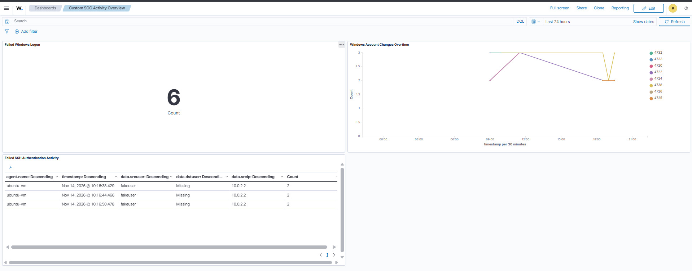

<div align="center">


\# 🛡️ Hybrid Wazuh SOC Lab

\### Detection Engineering, Automated Containment \& Threat Telemetry


\[!\[Wazuh](https://img.shields.io/badge/SIEM-Wazuh-blue?style=for-the-badge\&logo=wazuh)](https://wazuh.com)

\[!\[MITRE ATT\&CK](https://img.shields.io/badge/MITRE%20ATT\&CK-T1110%20%7C%20T1078-red?style=for-the-badge)](https://attack.mitre.org)

\[!\[Platform](https://img.shields.io/badge/Platform-Ubuntu%20%7C%20Windows%2011-lightgrey?style=for-the-badge\&logo=linux)](https://ubuntu.com)


\*A production-grade security monitoring and incident response lab engineered to bridge raw telemetry with automated defensive containment.\*


</div>


<br>


<p align="center">

&#x20; 

</p>


\---


\## 🎯 Executive Overview

This repository documents the end-to-end design, implementation, and hardening of a hybrid Security Information and Event Management (SIEM) environment. Built to mimic enterprise operations, the lab integrates an \*\*Ubuntu Linux Wazuh Manager\*\* with a \*\*Windows 11 host agent\*\* to practice core Security Operations Center (SOC) disciplines: writing custom correlation logic, analyzing multi-source logs, and orchestrating automated active responses.


\---


\## 🔍 Key Detection Engineering


Instead of relying solely on default signatures, this lab focuses on custom rules engineered to minimize noise and catch specific adversary behaviors mapped to the \*\*MITRE ATT\&CK®\*\* framework.


| Rule ID | Severity | Threat Vector / Description | MITRE ATT\&CK |

| :---: | :---: | :--- | :---: |

| `100101` | \*\*Level 10\*\* | Sliding-window SSH brute-force correlation ($\\ge 3$ failures in 120s from same source IP) | \*\*T1110\*\* (Brute Force) |

| `100200` | \*\*Level 12\*\* | Unauthorized activation of the built-in Windows `Guest` account (Security Event `4722`) | \*\*T1078\*\* (Valid Accounts) |


👉 \*Explore the annotated detection logic in \[rules/local\_rules.xml](rules/local\_rules.xml).\*


\---


\## ⚡ Automated Containment \& The "Self-Lockout" Lesson

To bridge detection with automated remediation, the lab enforces a host-level `firewall-drop` Active Response script tied to brute-force triggers. 


\* \*\*The Engineering Challenge:\*\* Because the lab operated in VirtualBox NAT mode, incoming host traffic resolved on the guest VM as the hypervisor gateway (`10.0.2.2`). When Wazuh successfully dropped the attacker IP, it inadvertently severed the management tunnel—locking out both the active SSH terminal and the OpenSearch web dashboard.

\* \*\*The Resolution:\*\* Added an explicit 60-second recovery timeout (`<timeout>60</timeout>`) and documented production safeguards (gateway allowlisting, network segregation).


👉 \*Read the full incident breakdown in \[docs/lessons-learned.md](docs/lessons-learned.md).\*


\---


\## 📐 Architecture \& Telemetry Pipeline


\* \*\*Management Plane:\*\* Ubuntu Linux VM hosting the \*\*Wazuh Manager\*\*, \*\*Indexer (OpenSearch)\*\*, and \*\*Web Dashboard\*\*.

\* \*\*Endpoint Plane:\*\* Windows 11 Home Host (`Agent 002`) forwarding structured Security Event channels and File Integrity Monitoring (FIM).

\* \*\*Network Topology:\*\* VirtualBox NAT mode utilizing explicit port forwarding (`2222` for SSH, `4433` for Dashboard).


👉 \*View the full network specifications in \[docs/architecture.md](docs/architecture.md).\*


\---


\## 📂 Repository Navigation


```text

hybrid-wazuh-soc-lab/

├── README.md                          # You are here

├── rules/

│   └── local\_rules.xml                # Custom XML detection rules

├── configs/

│   └── ossec\_snippets.xml             # Active Response \& FIM configuration snippets

├── docs/

│   ├── architecture.md                # Detailed topology \& port-mapping breakdown

│   └── lessons-learned.md             # Real-world engineering hurdles \& self-lockout post-mortem

├── testing/

│   └── attack-simulation.md           # Step-by-step testing runbook \& wazuh-logtest workflows

└── screenshots/                       # Visual evidence of rules firing \& active responses

```


\---


\## 🚀 Quick Links \& Documentation

\* \*\*\[Architecture Specifications](docs/architecture.md)\*\* — Deep dive into host-guest mapping and ingestion pipelines.

\* \*\*\[Attack Simulation Runbook](testing/attack-simulation.md)\*\* — How telemetry was generated and validated using `wazuh-logtest`.

\* \*\*\[Lessons Learned](docs/lessons-learned.md)\*\* — Operational takeaways from configuring SIEM pipelines and active response blocks.


\---

<p align="center"><i>Built with 🛡️ for aspiring Cybersecurity Engineers and Threat Hunters.</i></p>

