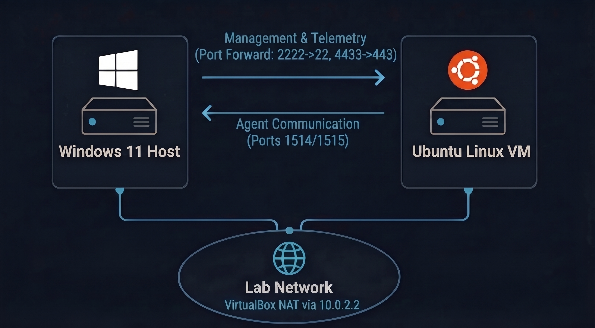

# Architecture & Topology

## Overview
This hybrid Wazuh SOC lab integrates a virtualized Linux management plane with a Windows 11 host agent to simulate security monitoring, log collection, custom rule correlation, and automated containment.

---

## Topology Diagram

*Figure: End-to-end traffic flow, port-forwarding tunnels, and network translation between the Windows 11 host and the Ubuntu Wazuh manager over VirtualBox NAT mode.*

---

## Port Forwarding & Communication Table

| Service / Purpose | Host Port | Guest (VM) Port | Description |
| :--- | :--- | :--- | :--- |
| **SSH Access** | `2222` | `22` | Management access to Ubuntu VM and attack simulation vector |
| **Wazuh Dashboard** | `4433` | `443` | HTTPS Web UI for threat hunting, dashboards, and alerts |
| **Wazuh Agent Enrollment** | `1515` | `1515` | Control channel used by agents to register with the manager |
| **Wazuh Agent Connection** | `1514` | `1514` | Encrypted TCP/UDP telemetry stream from agent to manager |
| **Wazuh RESTful API** | *Internal* | `55000` | Internal communication channel between Dashboard and Manager |

---

## Core Telemetry Pipelines

* **Windows 11 Host (Agent 002):** Captures structured Windows Security Event logs and forwards them to the manager over TCP port `1514`.
* **Ubuntu Linux VM (Manager & Indexer):** Processes local system logs (`auth.log`, `journald`), evaluates custom correlation rules against incoming events, and indexes data into the OpenSearch database backend.